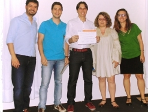

I'm a Data Scientist and AI/ML Researcher with a passion for exploring both the theoretical foundations and real-world applications of Artificial Intelligence and Machine Learning. For over 14 years, I've been developing methods and algorithms across areas such as Sentiment Analysis, Computer Vision, Predictive Analytics, and Natural Language Processing (NLP). Along the way, my research has been published in leading scientific journals, including IEEE Transactions on Fuzzy Systems, Information Sciences, ACM Computing Surveys, and Neurocomputing.

I joined the OCTO Research Office at Dell Technologies in 2022 and later moved to the AI-Centric Engineering team. Today, I lead research initiatives and projects exploring cutting-edge AI/ML technologies, with a particular interest in Anomaly and Novelty Detection, AI Reasoning, Continual Learning, Federated Learning, Data Fusion, Edge Intelligence, and Large Language Models (LLMs). My work bridges scientific research and practical innovation, turning promising ideas into technologies that can address real-world challenges.

Before joining Dell, I was an Associate Professor at the School of Sciences and Engineering (FCE) at São Paulo State University (UNESP/Tupã), where I taught Computer Science courses, conducted research, and mentored students. I also served as a faculty member in the Electrical Engineering Graduate Program (PPGEE/UNESP/Sorocaba-SJBV). Later, I became part of H.IAAC, the Artificial Intelligence and Cognitive Architectures Hub at the University of Campinas (UNICAMP), where I completed my postdoctoral research on Cognitive Architectures.

One of the highlights of my academic journey came in 2016, when I won 1st place in the X Competition of Theses and Dissertations in Artificial and Computational Intelligence at BRACIS 2016. My academic background is rooted in the University of São Paulo (USP), where I earned my Ph.D. in Computer Science (2015), M.Sc. in Computer Science (2011), and B.Sc. in Computer Information Systems (2009), all at the Institute of Mathematics and Computer Sciences (ICMC) in São Carlos, Brazil.

My research interests span several areas of Machine Learning, particularly Semi-supervised Learning, Ensemble Methods, Classification, and Clustering. I'm also interested in Bio-inspired Computing, including Evolutionary and Genetic Algorithms, Metaheuristics, and Artificial Neural Networks, from traditional architectures to modern Deep Learning models such as CNNs, GANs, and Transformers.

And here's a fun fact: my academic research in Agriculture 4.0/5.0, especially crop monitoring and threat detection, led me to become a drone pilot! 

---

For more details about my research and teaching, please visit my CV Lattes (in Portuguese) or explore the links below:

<a href="https://bv.fapesp.br/pt/pesquisador/80179/luiz-fernando-sommaggio-coletta" target="_blank">BV-FAPESP</a> ▪️ 
<a href="https://scholar.google.com/citations?user=rt8u0ZsAAAAJ&hl=pt-BR&oi=ao" target="_blank">Google Scholar</a> ▪️ 
<a href="https://www.scopus.com/authid/detail.uri?authorId=50861102400" target="_blank">Scopus</a> ▪️ 
<a href="https://orcid.org/0000-0002-4542-8591" target="_blank">ORCID</a> ▪️ 
<a href="https://www.researchgate.net/profile/Luiz-Coletta" target="_blank">Research Gate</a> ▪️ 
<a href="https://www.linkedin.com/in/luiz-coletta/" target="_blank">LinkedIn</a>

---

## My Thematic Evolution

A visual overview of how my research interests and expertise in AI and Machine Learning have evolved throughout my academic and industry career.

flowchart TD
    subgraph Phase1["🔬 Undergraduate & Graduate Research at USP (2009-2015)"]
        direction TB
        A["Fuzzy Clustering and Feature Selection (2009-2010)"] --> B["Distributed / Collaborative Clustering (2011-2012)"]
        B --> C["Classifier + Cluster Ensembles (2013-2015)"]
        B --> D["Metaheuristic Optimization (2013-2015)"]
        C --> E["Semi-Supervised Learning (2014-2016)"]
    end

    subgraph Phase2["👨‍🏫 Assistant Professor at UNESP (2016-2022)"]
        direction TB
        F["Sentiment Analysis / NLP (2016)"]
        F --> G["Computer Vision + Active Learning (2019-2022)"]
        G --> H["UAV + Agricultural AI (2021-2022)"]
        G --> I["Cognitive Agents / Architectures (2022-2023)"]
    end

    subgraph Phase3["💼 Senior Data Scientist at Dell (2022-Present)"]
        direction TB
        J["
• Anomaly & Novelty Detection • AI Reasoning & World Models • Continual & Federated Learning • Data Fusion & Edge AI • LLMs & RAG & Evals (Metrics & Reliability)
"]
    end

    Phase1 --> Phase2 --> Phase3

