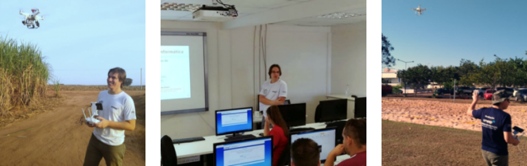

I am a data scientist and AI/ML researcher, working on both theoretical and applied problems in Artificial Intelligence and Machine Learning. For more than 14 years, I have been developing methods and algorithms in areas such as Sentiment Analysis, Computer Vision, Predictive Analytics, and Natural Language Processing (NLP). My research has been published in leading journals, including IEEE Transactions on Fuzzy Systems, Elsevier Information Sciences, ACM Computing Surveys, and Elsevier Neurocomputing.

I joined the OCTO Research Office at Dell Technologies in 2022 and, more recently, became part of the AI-Centric Engineering team, where I lead research studies and projects that apply cutting-edge AI/ML techniques, with a focus on Anomaly and Novelty Detection, AI Reasoning, Continual Learning, Federated Learning, Data Fusion, Edge Intelligence, and Large Language Models.

Previously, I was an Associate Professor at the School of Sciences and Engineering (FCE) of São Paulo State University (UNESP/Tupã) and a faculty member in the Electrical Engineering Graduate Program (PPGEE/UNESP/Sorocaba-SJBV), where I taught courses and advised students. I was also a member of H.IAAC - the Artificial Intelligence and Cognitive Architectures Hub at the State University of Campinas (UNICAMP) - where I completed my postdoctoral research on Cognitive Architectures.

In 2016, I was awarded 1st place in the X Competition of Theses and Dissertations in Artificial and Computational Intelligence at the 5th Brazilian Conference on Intelligent Systems (BRACIS 2016). I earned my Ph.D. in Computer Science in 2015 from the Institute of Mathematics and Computer Sciences (ICMC) at the University of São Paulo (USP), São Carlos, Brazil. At the same institution, I also received my M.Sc. in Computer Science in 2011, and my B.Sc. in Computer Information Systems in 2009.

My main research interests lie in Machine Learning - including Semi-supervised Learning, Ensembles, Classification, and Clustering - as well as Bio-inspired Computing techniques such as Evolutionary and Genetic Algorithms, Metaheuristics, and Artificial Neural Networks (both shallow and deep, e.g., MLPs, CNNs, GANs, Transformers).

Thanks to my academic research on Agriculture 4.0/5.0, particularly in crop monitoring for threat detection, I also became a drone pilot!

For more details about my research and teaching, please visit my CV Lattes (in Portuguese) or explore the links below:

<a href="https://bv.fapesp.br/pt/pesquisador/80179/luiz-fernando-sommaggio-coletta" target="_blank">BV-FAPESP</a> - 
<a href="https://scholar.google.com/citations?user=rt8u0ZsAAAAJ&hl=pt-BR&oi=ao" target="_blank">Google Scholar</a> - 
<a href="https://www.scopus.com/authid/detail.uri?authorId=50861102400" target="_blank">Scopus</a> - 
<a href="https://orcid.org/0000-0002-4542-8591" target="_blank">ORCID</a> - 
<a href="https://www.researchgate.net/profile/Luiz-Coletta" target="_blank">Research Gate</a> - 
<a href="https://www.linkedin.com/in/luiz-coletta/" target="_blank">LinkedIn</a>

## Thematic Evolution

flowchart TD
    subgraph Phase1["🔬 Undergraduate & Graduate Research at USP (2009-2015)"]
        direction TB
        A["Fuzzy Clustering and Feature Selection (2009-2010)"] --> B["Distributed / Collaborative Clustering (2011-2012)"]
        B --> C["Classifier + Cluster Ensembles (2013-2015)"]
        B --> D["Metaheuristic Optimization (2013-2015)"]
        C --> E["Semi-Supervised Learning (2014-2016)"]
    end

    subgraph Phase2["👨‍🏫 Assistant Professor at UNESP (2016-2022)"]
        direction TB
        F["Sentiment Analysis / NLP (2016)"]
        F --> G["Computer Vision + Active Learning (2019-2022)"]
        G --> H["UAV + Agricultural AI (2021-2022)"]
        G --> I["Cognitive Agents / Architectures (2022-2023)"]
    end

    subgraph Phase3["💼 Senior Data Scientist at Dell (2022-Present)"]
        direction TB
        J["
• Anomaly & Novelty Detection • AI Reasoning & World Models • Continual & Federated Learning • Data Fusion & Edge AI • LLMs & RAG & Evals (Metrics & Reliability)
"]
    end

    Phase1 --> Phase2 --> Phase3

