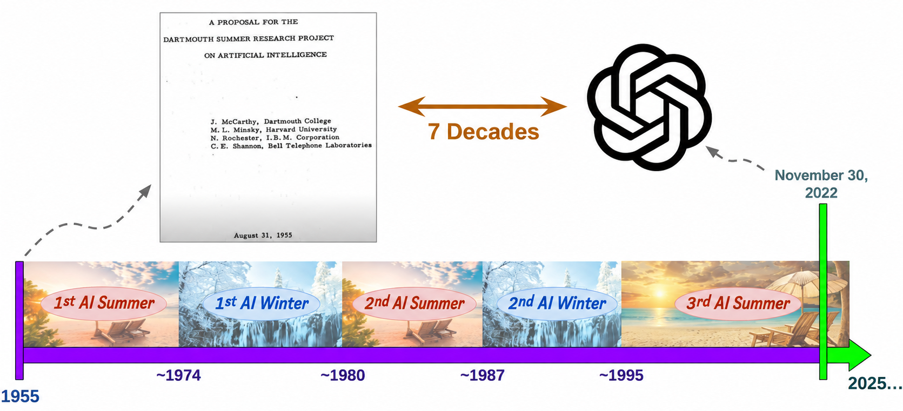

 AI predates the emergence of ChatGPT, and its journey has featured exciting, prosperous summers; but also dramatic winters. 

Some of you may be surprised by that number, but it has already been 70 years since AI first emerged! In 1955, the term “Artificial Intelligence” appeared in a proposal for a conference at Dartmouth, led by John McCarthy, Marvin Minsky, Nathaniel Rochester, and Claude Shannon. Its beginnings, marked by that conference, were filled with virtually boundless optimism. People believed that AI's main challenges would be solved quickly. Yet, as illustrated below, AI went on to follow a winding path of discoveries and twists and turns that, over the decades, not only redefined technologies but also challenged how we understand our own intelligence.

 Figure 1. The summers and winters of AI, highlighting the first proposal to study AI and, more recently, the launch of ChatGPT by OpenAI. 

Looking at these ups and downs, I'll highlight four developments or consequences that brought us to the AI we know today:

## 1. Discovering Error as a Signal for Emulating Intelligence

In the early decades, people believed human intelligence could quickly be emulated through formal rules grounded in mathematical logic (propositional and predicate logic), an approach that came to be known as Symbolic AI. Real-world problems, however, often involve uncertainty, incomplete information, and other complications that limited the use of logic in AI to formally well-behaved, unambiguous situations.

Around the same time, Frank Rosenblatt proposed the Perceptron, a mathematical representation (an imitation) of a human neuron. This paved the way for what became known as Connectionist AI: an approach focused on developing Artificial Neural Networks (ANNs). The premise was:

> To emulate human intelligence, all we would need to do is copy the human brain.

From the Perceptron in 1958 to Backpropagation in 1986, the evolution of ANNs ultimately did not produce an artificial brain, but it did capture one of its most vital principles: plasticity, the brain's ability to continuously reshape itself in response to experience. This phenomenon is part of the biological foundation of human learning - and it would save AI decades later! The idea of plasticity was mimicked through an error signal whose magnitude would trigger adaptations in ANNs, allowing them to continually correct their mistakes.

By quantifying failure (error) and formally using it as a signal to adjust the system, the foundation was laid for an entire subfield of AI that would grow tremendously in the future: Machine Learning (ML).

## 2. The Frustrating Discovery That Copying Human Knowledge Wasn't Enough

In 1969, Marvin Minsky and Seymour Papert's book *Perceptrons: An Introduction to Computational Geometry* mathematically demonstrated the limitations of the single-layer Perceptron - such as its inability to solve non-linearly separable problems (e.g., a simple XOR function). That criticism helped bring about the most notable AI winter, severely freezing progress across the field!

Years later, Expert Systems found room to flourish. The idea now was to capture human knowledge through explicit rules, manually encoded from the experience of domain experts. The reasoning was that:

> A machine or system could match the performance of a human expert in a given domain, provided that the expert's knowledge could be adequately extracted and formalized into a rule base the system could use.

These systems enjoyed periods of success. However, rooted in Symbolic AI, they suffered from the same problem. Copying experts' knowledge into (rigid) rules turned out to be far too complex for countless human intellectual tasks. Rule bases could grow uncontrollably, were difficult to maintain, scaled poorly, and could not organically incorporate new knowledge. Moreover, their direct dependence on human experts introduced biases and bottlenecks, frustrating both the development of these systems and their subsequent maintenance and correction.

At some point, it was time to throw in the towel: it became clear that, to reproduce human decision-making, the focus had to shift - from statically encoding human knowledge to dynamically modeling human experience! In his book *Machine Learning* (1997), Tom Mitchell presented the seminal definition of Machine Learning:

> A computer program is said to learn from experience E with respect to some class of tasks T and performance measure P, if its performance at tasks in T, as measured by P, improves with experience E.

That tongue twister became a real mantra as we began training ML models using data (experience) to enable them to perform particular tasks.

## 3. Back to a Symbolic Language, Now as Complex as AI's New Challenges

From the 2000s onward, multiple technological advances brought about what came to be known as Big Data: the staggering availability of ever-growing amounts of data about virtually everything imaginable became a reality, just as the old-school Data Mining experts had predicted.

Data galore and major advances in hardware created the perfect storm for the next big thing: Deep Learning. Especially after AlexNet's impact in 2012, AI/ML shifted its attention toward unstructured data, such as images, audio, and natural language. This progress propelled fields such as Computer Vision, Natural Language Processing, and Speech Recognition. Consequently, it also laid the groundwork for a new generation of generative models, more practical and scalable than those available before.

Deep Learning marked the beginning of a new era in Machine Learning, in which the very features used for inference began to be learned by the models themselves. Advances in learning deep data representations - such as text embeddings - and the emergence of the Transformer architecture in 2017 captured practically all the field's attention!

Discriminative models - widely used in practice and effective with tabular data, which had long formed the basis of most problems being tackled - were gradually pushed into the background with the arrival of Large Language Models (LLMs), colossal Transformer-based models. Equipped with generative capabilities, LLMs use human language as a starting point: a statistical and symbolic “seed” for generating textual content.

From 2021 to the present, we've been experiencing the hottest summer of all time. The beaches are packed, and people are coming from everywhere looking for their place in the sun. At the same time, enormous efforts have been made to overcome LLM limitations, particularly when trying to adapt this technology to specialized domains. Insufficient context, hallucinations, difficulty measuring response quality, and the high costs of training and operating these models all show that AI has reached an impressive level of sophistication and capability. Yet a full understanding of reality, comparable to the human kind, remains a distant horizon.

As Yann LeCun points out, LLMs face structural limitations when operating in specialized domains and learning beyond what they observed during training, since they do not build explicit models of the world (they only “understand” how to predict text), nor do they continuously accumulate knowledge or experience. This reinforces the need for architectures that go beyond the “simple” statistical generation of human language.

## 4. Who Would Have Thought That Stacking Agents Would Give Us the Hottest - and, Paradoxically, the Shallowest - Summer in AI History?

The transition from passive AIs (limited to chatting and answering questions) to active AIs, capable of using tools, browsing the web, writing and executing code, and making decisions with “little” human intervention, marks an important advance in recent years. However, this leap did not come from a fundamental change in how models learn or represent the world, but mainly from orchestrating capabilities that already existed.

This orchestration is tied to the rise of so-called Agentic AI: multiple components - AI agents that typically encapsulate ML models interacting with external tools, memory, and so on - are combined to exhibit planning, reasoning, learning, and other abilities in an effort to solve complex tasks.

As a result, we are now experiencing a wave of technical euphoria in which progress is demonstrated mainly by the ability to find the most suitable combination or sequence of these agentic components to provide a specific solution to an equally specific problem, more often than not. In most cases, this leaves the core cognitive limitations of the models and of the system as a whole untouched.

The result is fragmented architectures, limited standardization, and no guarantees that successful solutions can be reused - making it difficult for the community to achieve meaningful consolidation. In the process, LLMs are frequently treated as central building blocks in pipelines, sometimes applied almost indiscriminately to problems of very different kinds, including those for which language models would not be an appropriate choice among the available ML tools.

This movement carries a significant methodological risk: the weakening of established Machine Learning practices. Careful modeling, feature engineering, controlled training, and statistical validation - crucial in structured and tabular-data domains - are giving way to empirical approaches based on prompting, manual tweaks, and ad hoc agent experimentation. As a result, effort has shifted away from deeply understanding a problem and rigorously developing its solution toward, all too often, simply obtaining something that works through “trial and error” by varying or modifying prompts.

LLMs have therefore been tremendously important, especially in making AI massively popular around the world, to the point that the community interested in AI has exploded in size. Unfortunately, that growth has not been matched by the depth of understanding that should accompany work with AI and its advances - many people do not even know that AI existed long before ChatGPT was launched in 2022.

To wrap up, agents are not a new concept in AI; they have simply evolved and are now enjoying their moment in the spotlight. Renewed waves of interest in previously overlooked topics are part of AI's history (sometimes, old ideas return to breathe new life into the field). In this sense, while we are going through a period of superficiality despite an overheated summer (even forming a bubble that could burst at any moment), future progress will depend on deeper changes in architectures, techniques, methods, and algorithms. Such changes may emerge by revisiting established foundations from the past (e.g., Transformers/Attention, BERT encoders, RNNs, LSTMs/GRUs, Backpropagation, GNNs, etc.) or alternatives to them (e.g., State Space Models such as S4/S5, RWKV, and Mamba; Neural ODEs, Kolmogorov-Arnold Networks, Diffusion-LMs, Hyena, TCNs, World Models, MoE, xLSTM, etc.). And if today's summer eventually gives way to another winter, the people who will drive the next transformation will be those who truly understand the field, its history, and its literature: AI's next major breakthrough could come just as easily from a newly published scientific paper as from a forgotten study from the previous decade - which is often where genuine innovation in this field begins.